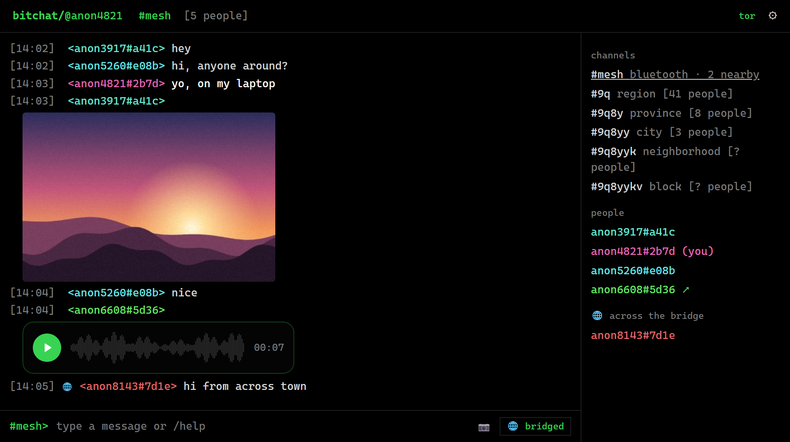

<h1 align="center">bitchat-desktop</h1>

<p align="center">
  An unofficial <a href="https://github.com/permissionlesstech/bitchat">bitchat</a> client for <b>Windows</b> and <b>Linux</b>.<br>
  Talks to the iPhone, Mac and Android apps over Bluetooth and over the internet.
</p>

<p align="center">
  
  
  
</p>

<p align="center">
  
</p>

## What works

| | |
|---|---|
| **Bluetooth mesh** (`#mesh`) | Public chat, private messages, relaying and sync with phones nearby. The PC both scans and advertises, so phones find it too. |
| **Location channels** | Geohash channels over Nostr (region down to block), people counts, teleporting, location notes (`/drop`). |
| **Private messages** | Noise-encrypted over Bluetooth, gift-wrapped over Nostr, with delivered and read receipts. |
| **Images and voice messages** | Send images in `#mesh` and Bluetooth private chats (encrypted in private chats). Like the phones, images are shrunk and stripped of location data before sending. Voice messages from phones play with a waveform. |
| **Favorites** | Star someone in `#mesh` and keep messaging them over the internet when you're apart. |
| **Mesh bridge** | Joins nearby Bluetooth groups over the internet. Messages from across the bridge show with 🌐. Also carries traffic for phones around you that have no internet. |
| **Commands** | `/msg` `/who` `/hug` `/slap` `/block` `/unblock` `/fav` `/unfav` `/drop` `/clear` `/help` |
| **Panic wipe** | Triple-click the `bitchat/` logo to erase everything and start as a new person. |
| **Privacy** | Tor on by default. Keys kept in the system keychain, saved data encrypted. |

Not yet: recording voice messages, live voice, sending files, groups, QR verification, `/ping`, `/trace`, payments. On macOS, use the official app.

## Using it

- `#mesh` is the Bluetooth chat; the channels under it are location channels around you. Click the channel name at the top to go to any geohash.
- Click a name to chat privately. The ☆ in a private chat makes them a favorite.
- 📷, or pasting an image, sends it in `#mesh` or in a Bluetooth private chat.
- Settings (⚙) has your nickname, Tor, extra relays and the mesh bridge.

## Compatibility

Works with bitchat **1.8** for iPhone and Mac and **2.2** for Android. The packet format, Noise handshake, Nostr envelopes, bridge carriers and file transfers are checked in CI against test vectors produced by the iOS code, in both directions.

## Requirements

- **Windows 10 or 11.** For location channels near you, turn on location for desktop apps in Windows settings.
- **Linux** with BlueZ. Location comes from GeoClue if it's available. Playing voice messages needs GStreamer's AAC decoder (`gstreamer1.0-libav`).

The Bluetooth built into most laptops is all you need for `#mesh`; a desktop without Bluetooth can use any USB dongle. Without Bluetooth, everything that goes over the internet still works.

## Build

There are no downloads yet. You need Rust and Node.js. On Linux also install `libwebkit2gtk-4.1-dev librsvg2-dev libssl-dev libdbus-1-dev`.

```
cd app
npm install
npx tauri dev      # run it
npx tauri build    # make an installer
```

### Bluetooth on Linux

BlueZ's battery plugin makes iPhones ask to pair when they connect. bitchat doesn't need pairing, so turn the plugin off:

```
sudo mkdir -p /etc/systemd/system/bluetooth.service.d
printf '[Service]\nExecStart=\nExecStart=/usr/libexec/bluetooth/bluetoothd -P battery\n' | \
  sudo tee /etc/systemd/system/bluetooth.service.d/no-battery.conf
sudo systemctl daemon-reload && sudo systemctl restart bluetooth
```

The path to `bluetoothd` can differ by distro (`/usr/lib/bluetooth/bluetoothd` on some).

## Layout

| Folder | |
|---|---|
| `crates/bitchat-proto` | Packet format, padding, compression, geohashes |
| `crates/bitchat-noise` | Noise XX sessions |
| `crates/bitchat-mesh` | Mesh node: announces, relaying, fragments, sync |
| `crates/bitchat-ble` | Bluetooth for Windows and Linux |
| `crates/bitchat-nostr` | Nostr events, envelopes, relays, Tor |
| `crates/bitchat-core` | The app itself: channels, DMs, favorites, bridge, commands |
| `app` | Desktop UI (Tauri + Svelte) |
| `tools/swift-vectors` | Tests that run against the iOS code |

## License

Public domain ([Unlicense](LICENSE)), like bitchat.
